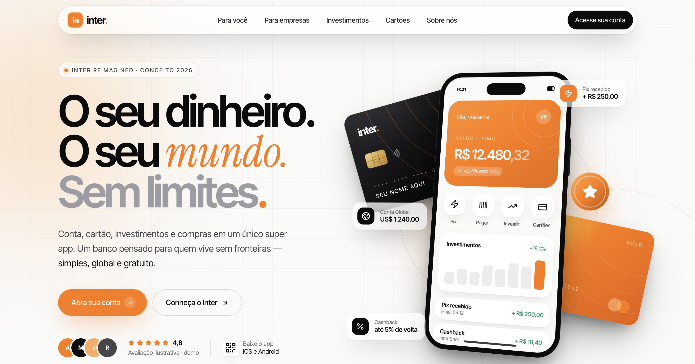
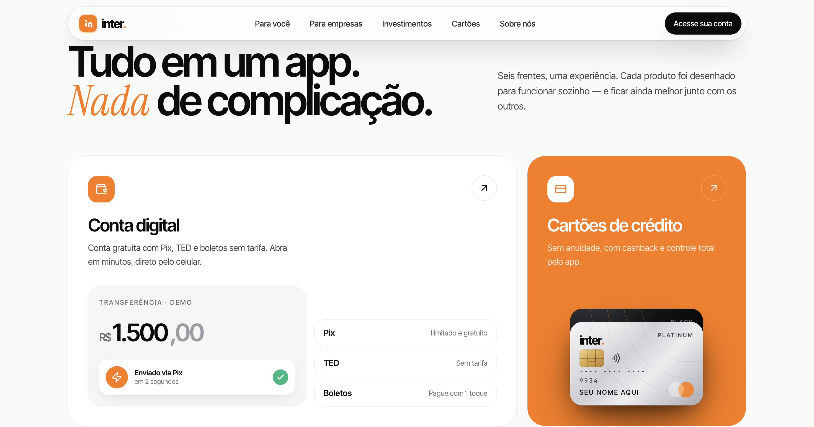
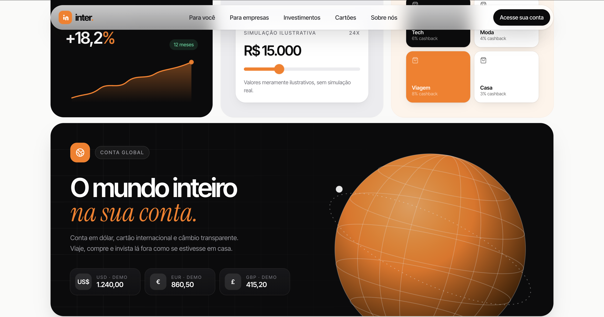
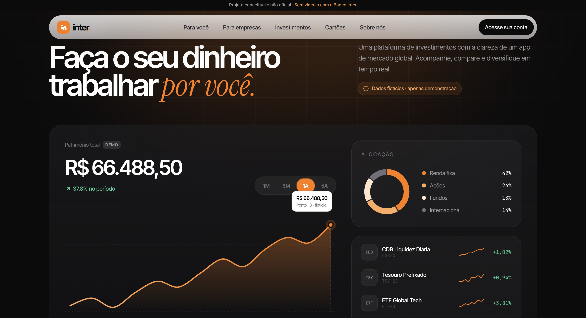
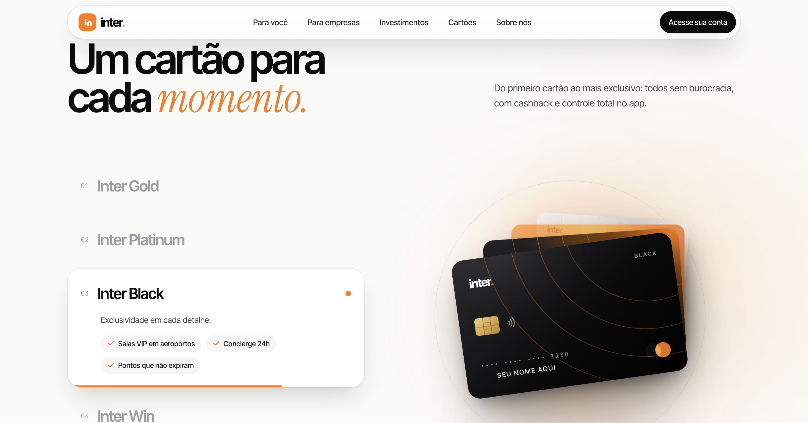
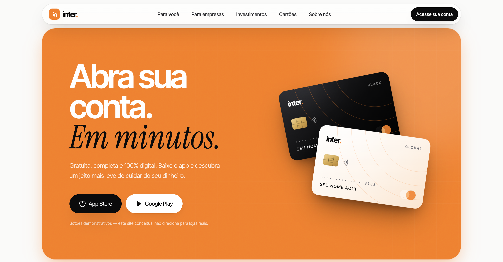

<h1 align="center">
  <br>
  Site Redesenhado Banco Inter
  <br>
</h1>

<p align="center">
  Site do Banco Inter redesenhado do zero, com React, Vite e Tailwind CSS.
</p>

<p align="center">
  
  
  
  
  
</p>

---

## Sobre o projeto

Este é um **conceito de landing page** para um banco digital, construído com React, Vite e Tailwind CSS. A proposta é imaginar como seria o site do Inter se ele fosse redesenhado do zero: tipografia grande, muito espaço em branco, o laranja como cor de destaque e microinterações em cada seção.

Não há backend nem login. Saldos, rendimentos, cartões e simulações são **fictícios**, e os botões de "Abrir conta" e "Entrar" só abrem um aviso, sem coletar nenhum dado.

O layout funciona do celular ao desktop, com menu próprio no mobile, e respeita a preferência de **movimento reduzido** do sistema.

> Projeto sem vínculo com o Banco Inter. Marcas e nomes pertencem aos seus respectivos donos.

---

## Seções

### Topo da página

| | |
|---|---|
| **Cabeçalho** | Fica translúcido ao rolar a página, com navegação por âncoras e menu de tela cheia no celular |
| **Hero** | Título em destaque, celular com o app em CSS e cartões flutuantes (Pix recebido, Cashback, Conta Global) que reagem ao movimento do mouse |
| **Faixa de destaques** | Letreiro contínuo com os principais benefícios: Pix ilimitado, cartão sem anuidade, investimentos a partir de R$ 1… |

### Produtos e serviços

| | |
|---|---|
| **Produtos** | Grade com Conta digital, Cartões, Investimentos, Empréstimos, Inter Shop e Conta Global, cada um com uma ilustração própria e efeito de luz que segue o cursor |
| **Simulador de empréstimo** | Controle deslizante de R$ 1.000 a R$ 50.000 |
| **Investimentos** | Gráfico de patrimônio com períodos 1M, 6M, 1A e 5A, valor no ponto sob o cursor, rosca de alocação da carteira e lista de ativos com minigráficos |
| **Cartões** | Carrossel automático com os cartões Gold, Platinum, Black e Win feitos 100% em CSS, inclinação 3D ao passar o mouse e pausa ao interagir |

### Institucional

| | |
|---|---|
| **Diferenciais** | Cinco tópicos em lista; a ilustração ao lado muda conforme o tópico entra no centro da tela |
| **Sobre nós** | Manifesto em que as palavras acendem uma a uma conforme a rolagem |
| **Chamada final** | Convite para abrir a conta, com os cartões Black e Global flutuando ao lado |
| **Rodapé** | Links de Produtos, Para empresas, Institucional e Ajuda, além das redes sociais |

---

## Cartões

<p>
  
  
  
  
</p>

Cada cartão é desenhado só com gradientes e padrões em CSS, sem imagens. O carrossel troca de cartão a cada 5 segundos e exibe o slogan e os benefícios do cartão ativo.

---

## Telas

<table align="center">
  <tr>
    <td align="center" width="50%">
      
      <br/><sub><b>Hero</b> · título, celular com o app e cartões flutuantes</sub>
    </td>
    <td align="center" width="50%">
      
      <br/><sub><b>Produtos</b> · Conta digital e Cartões de crédito</sub>
    </td>
  </tr>
  <tr>
    <td align="center" width="50%">
      
      <br/><sub><b>Produtos</b> · Empréstimos, Inter Shop e Conta Global</sub>
    </td>
    <td align="center" width="50%">
      
      <br/><sub><b>Investimentos</b> · gráfico de patrimônio, alocação e ativos</sub>
    </td>
  </tr>
  <tr>
    <td align="center" width="50%">
      
      <br/><sub><b>Cartões</b> · carrossel 3D com o Inter Black em destaque</sub>
    </td>
    <td align="center" width="50%">
      
      <br/><sub><b>Chamada final</b> · "Abra sua conta. Em minutos."</sub>
    </td>
  </tr>
</table>

---

## Como rodar

```bash
npm install
npm run dev       # http://localhost:5173
npm run build     # gera a versão de produção em dist/
npm run preview   # serve a versão de produção localmente
```

---

## Tecnologias

| Tecnologia | Descrição |
|---|---|
| React 18 | Biblioteca de interface, com hooks próprios para as animações |
| Vite 5 | Servidor de desenvolvimento e build |
| Tailwind CSS 3 | Estilização, com paleta `brand` (laranja) e `ink` (neutros), sombras e animações personalizadas |
| Lucide React | Ícones |
| SVG próprio | Gráfico de patrimônio, rosca de alocação e minigráficos, sem biblioteca de gráficos |
| Google Fonts | Inter Tight (texto), Instrument Serif (destaques em itálico) e JetBrains Mono (números) |

### Hooks de interação

| Hook | Uso |
|---|---|
| `useReveal` | Faz os elementos surgirem quando entram na tela (IntersectionObserver) |
| `useCountUp` | Anima números de 0 até o valor final |
| `useTilt` | Inclinação 3D que acompanha o ponteiro |
| `useSpotlight` | Brilho que segue o cursor nos cards |
| `useScrolled` | Detecta a rolagem para mudar o cabeçalho |

---

## Estrutura

```
src/
  App.jsx                # ordem das seções e controle do modal de aviso
  index.css              # base, componentes (glass, grain, grid-lines, spotlight) e movimento reduzido
  components/
    sections/            # Header, Hero, Products, Investments, Cards, Features, About, CTA, Footer, DemoModal
    ui/                  # BankCard, Button, Logo, Reveal, SectionHeading
  hooks/                 # useReveal, useCountUp, useTilt, useSpotlight, useScrolled
  data/content.js        # textos, cartões, carteira e links
tailwind.config.js       # cores, fontes, sombras e animações
```
